# База данных

PostgreSQL 16. ORM — Drizzle (`apps/api/src/database/schema.ts` — единственный источник схемы). Именование — `snake_case` (`casing: 'snake_case'`). Расширение `pg_trgm`.

## Принципы
- **Нормализация**: справочники (категории, характеристики, регионы, тарифы) отдельно; значения характеристик — EAV-таблица `listing_attribute_values` с типизированными колонками (`value_text`, `value_number`, `value_bool`) и индексами `(attribute_id, value)`.
- **Целостность**: внешние ключи везде (`restrict` для финансовых связей, `cascade` для зависимых данных), CHECK-ограничения (цены ≥ 0, суммы заказа, рейтинг 1–5, неотрицательный бонусный баланс, сумма возврата ≤ сумме платежа, у пользователя есть email или телефон).
- **Деньги** — `bigint` копейки. Валюта — `varchar(3)`.
- **Конкурентность**: `version` (оптимистическая блокировка) у `listings` и `orders`; `SELECT … FOR UPDATE` при смене статусов, резерве количества, списании квот, применении платёжных статусов.
- **Идемпотентность**: `payments(user_id, idempotency_key)`, `payment_events(provider, provider_event_id)`, `refunds.idempotency_key`, `ledger_transactions.idempotency_key`, `messages(sender_id, client_message_id)`.
- **История**: `listing_status_history`, `order_status_history`, `moderation_decisions`, `audit_logs`, `security_events` — только вставка.
- **Поиск**: генерируемые колонки `listings.search_tsv` и `messages.body_tsv` (`to_tsvector('russian', translate(…,'ёЁ','еЕ'))`) с GIN-индексами; триграммный индекс по `listings.title`.
- **Пагинация**: offset для каталогов/админки (ограничено 100 страницами в поиске), курсор по времени для чатов и уведомлений.

## ER-диаграмма (основные сущности)

```mermaid
erDiagram
  users ||--o{ user_roles : has
  users ||--o{ sessions : has
  users ||--o{ auth_codes : receives
  users ||--o{ organization_members : member
  organizations ||--o{ organization_members : has
  regions ||--o{ regions : parent
  categories ||--o{ categories : parent
  categories ||--o{ category_attributes : defines
  attributes ||--o{ category_attributes : used_in
  attributes ||--o{ attribute_options : options
  users ||--o{ listings : owns
  organizations ||--o{ listings : publishes
  categories ||--o{ listings : classifies
  regions ||--o{ listings : located
  listings ||--o{ listing_attribute_values : values
  listings ||--o{ listing_media : photos
  media ||--o{ listing_media : used
  listings ||--o{ listing_status_history : history
  listings ||--o{ listing_stats_daily : stats
  listings ||--o{ moderation_decisions : moderated
  users ||--o{ favorites : likes
  listings ||--o{ favorites : liked
  users ||--o{ saved_searches : saves
  listings ||--o{ conversations : about
  conversations ||--o{ conversation_participants : has
  conversations ||--o{ messages : contains
  users ||--o{ notifications : gets
  users ||--o{ reviews : writes
  orders ||--o{ reviews : reviewed
  users ||--o{ complaints : files
  listings ||--o{ orders : sold
  orders ||--o{ order_status_history : history
  orders ||--o| shipments : shipped
  paid_services ||--o{ purchases : bought
  purchases ||--o{ listing_promotions : promotes
  purchases ||--o{ user_subscriptions : grants
  orders ||--o{ payments : paid
  purchases ||--o{ payments : paid
  payments ||--o{ payment_events : webhooks
  payments ||--o{ refunds : refunded
  ledger_transactions ||--o{ ledger_entries : entries
  ledger_accounts ||--o{ ledger_entries : posted
```

## Таблицы (50)

| Группа | Таблицы |
|---|---|
| Пользователи и доступ | `users`, `user_roles`, `sessions`, `auth_codes`, `external_identities` (задел под VK ID / Яндекс ID / ЕСИА), `user_blocks`, `organizations`, `organization_members` |
| Справочники | `regions`, `categories`, `attributes`, `attribute_options`, `category_attributes`, `paid_services`, `stop_words`, `platform_settings` |
| Объявления | `listings`, `listing_attribute_values`, `listing_media`, `media`, `listing_status_history`, `listing_stats_daily`, `moderation_decisions`, `listing_promotions` |
| Вовлечённость | `favorites`, `saved_searches`, `user_category_interests`, `recent_views` |
| Коммуникации | `conversations`, `conversation_participants`, `messages`, `notifications`, `notification_preferences`, `push_tokens`, `reviews`, `complaints` |
| Коммерция | `orders`, `order_status_history`, `shipments`, `purchases`, `user_subscriptions`, `payments`, `payment_events`, `refunds`, `ad_placements` |
| Учёт | `ledger_accounts`, `ledger_transactions`, `ledger_entries` |
| Журналы | `audit_logs`, `security_events` |

### Двойная запись (ledger)
Счета: `provider_clearing` (деньги у провайдера), `platform_revenue` (выручка), `seller_payable` (обязательства перед продавцом, по пользователю), `user_bonus` (бонусы, по пользователю, CHECK ≥ 0), `bonus_issued` (контрсчёт выпуска бонусов). Каждая операция — транзакция с проводками, сумма которых 0 (проверяется в коде, сверка — `GET /admin/ledger/trial-balance`).

| Операция | Проводки |
|---|---|
| Оплата заказа | provider_clearing +total; seller_payable(seller) −(total−commission); platform_revenue −commission |
| Возврат по заказу | обратные проводки пропорционально сумме возврата |
| Оплата услуги | provider_clearing +price; platform_revenue −price |
| Начисление бонусов | user_bonus +x; bonus_issued −x |
| Оплата бонусами | user_bonus −x; bonus_issued +x (не выручка) |

## Миграции
- Каталог `apps/api/drizzle`, генерация `npx drizzle-kit generate --name=…`, применение `node dist/database/migrate.js` (под `pg_advisory_lock`, безопасно при параллельном старте реплик).
- В деплое миграции — отдельный шаг (Job в Helm / сервис `migrate` в Compose) до выката новых подов.
- Изменения — только вперёд (expand → migrate → contract). Drizzle при пересоздании колонки не восстанавливает индексы — проверять SQL вручную (пример: `0002_yo_normalization.sql`).

## Резервное копирование
- `infra/backup/backup.sh`: `pg_dump -Fc` с ротацией + выгрузка в S3 (bucket backups). Расписание — CronJob в Helm (`backup.schedule`), по умолчанию ежедневно.
- Production: дополнительно WAL-архивирование (point-in-time recovery) средствами управляемой БД или pgBackRest — **настраивается на стороне инфраструктуры** (см. DEPLOYMENT.md).
- `infra/backup/restore.sh` — восстановление в указанную БД; проверка восстановления — ежемесячно на стенде.
- Медиа в S3 — версионирование бакета и репликация средствами провайдера.

## Рост данных
`messages`, `audit_logs`, `security_events`, `listing_stats_daily`, `notifications` — кандидаты на партиционирование по месяцу и ретеншн (настраивается при достижении ~50 млн строк). Ретеншн `security_events`/`auth_codes` — 6–12 месяцев (уточнить у юриста, см. LEGAL.md).
